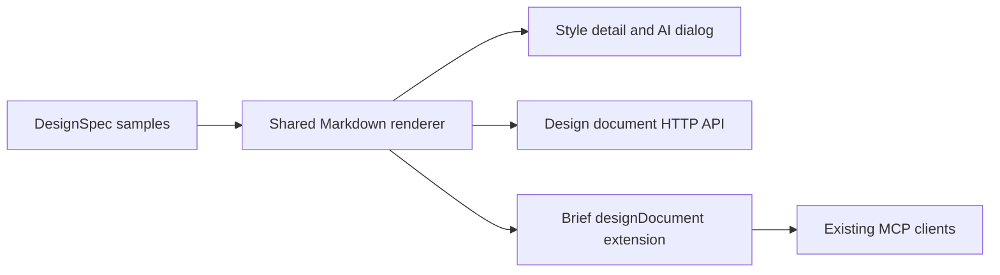

# Codebase map

StyleKit is one Next.js application with three developer packages. The catalog
contains individual style definitions and showcases; their separate files let
authors change one style without editing the entire catalog.

## Find a feature

| Responsibility | Location | Start here |
| --- | --- | --- |
| Pages and HTTP handlers | `app/` | Locale wrappers in `app/[locale]/`; style detail in `app/styles/[slug]/` |
| Product UI | `components/` | `components/ui/` for shared primitives; feature directories for composed UI |
| Domain behavior | `lib/` | Use the relevant feature entry point rather than adding behavior to pages |
| Style definitions, metadata and tokens | `lib/styles/` | `registry.ts`, `meta-registry.ts`, `tokens-registry-data.ts` |
| Component recipes | `lib/recipes/` | `registry.ts` and the style's recipe file |
| Complete design documents | `lib/design-spec/` | `types.ts`, `registry.ts`, `samples/`, `render/design-md.ts` |
| AI client setup | `lib/ai-access/`, `components/ai/` | `client-setups.ts`, `connect-ai-button.tsx` |
| Templates and source delivery | `app/templates/`, `lib/templates/`, `lib/assets/` | Follow the asset catalog before moving source files |
| Blog and reference content | `content/`, `knowledge/`, `experience-packs/` | Some handlers read these files at runtime |
| Public browser assets | `public/` | Keep product images and downloadable assets here |
| Developer packages | `packages/core/`, `packages/cli/`, `packages/mcp/` | Each package has its own entry point and build/test lifecycle |
| Verification | `tests/`, colocated `__tests__/` | Root Vitest config is `tests/vitest.config.ts`; E2E config is `tests/playwright.config.ts` |
| Maintainer utilities | `tools/scripts/` | Discover the corresponding command in `package.json` |

## One complete design document

The curated style's `DesignSpec` is the source for the complete `design.md`.
The style detail page renders it on the server and uses that same string for
preview, clipboard and download. The AI setup dialog reuses the page's string.
The MCP-facing brief adds the shared server document with its independent hash.

`lib/ai-access/index.ts` and `client-setups.ts` remain safe for the client bundle.
The document helper imports server dependencies and is imported by server
handlers directly, not re-exported through the client entry point.

## Compatibility surfaces

The public `/api/styles/[slug]/md`, IDE rule exports and existing brief fields
have consumers outside the website. They remain compatibility interfaces even
though the style-page UI offers the complete `design.md`. Keep their domain
builders and package exports when retiring unused UI. Historical analytics
event values and changelog entries are also retained.

For a style change, follow [the complete checklist](STYLE_ADDITION_CHECKLIST.md).
For a public API change, inspect Core, CLI, MCP and existing clients before
changing response formats or deleting exports.
